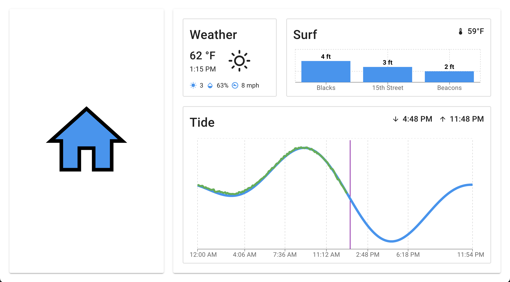

# Garage-UI

### A Custom UI For A Garage Door Opener



## About Project

After viewing the button on my family's garage wall for enough years, I decided to finally do something about it. I
imagined a world where there was a central database for important information about family endeavors, where one could go
for quick information at a glance, but also for more detailed info.

Thus, the Garage-Pi was born.

A Raspberry Pi runs this repo as an Electron app out of our garage. It of course has garage door controls, but it also
shows tide, weather, and surf data. The app is configured so that new data sources can be easily added at a later date.

## Installation

1. Flash Raspberry Pi OS (Lite or Desktop) with Raspberry Pi Imager, setting a username, Wi-Fi, and SSH in its settings.
2. Clone the repository and create a `.env` file in it (see below):
   ```
   git clone https://github.com/mrrosoff/Garage-UI.git && cd Garage-UI
   ```
3. Run the [install script](scripts/install.sh) as your normal user (not with `sudo`) from the Garage-UI directory:
   ```
   bash scripts/install.sh
   ```

The script installs the system packages, Node, and the app's dependencies, sets the Pi to log in to the console
automatically and launch Garage-UI, and schedules a weekly update and reboot. On every boot the Pi resets to the latest
`origin/main`, reinstalls dependencies if anything changed, and starts the app. Logs are in `logs/`.

## Environment Variables

We currently use the following environment variables:

```
VITE_LATITUDE=32.95325541910332
VITE_LONGITUDE=-117.24177865770446
VITE_ZIP_CODE=92130
VITE_NOAA_STATION=9410230
VITE_TIME_INTERVAL=60000

VITE_OPEN_WEATHER_MAP_ID="your-key-here"

VITE_SURF_SPOT_ONE_ID="5842041f4e65fad6a770883b"
VITE_SURF_SPOT_ONE_NAME="Blacks"

VITE_SURF_SPOT_TWO_ID="5842041f4e65fad6a77088af"
VITE_SURF_SPOT_TWO_NAME="15th Street"

VITE_SURF_SPOT_THREE_ID="5842041f4e65fad6a77088b1"
VITE_SURF_SPOT_THREE_NAME="Cardiff Reef"

VITE_SURF_SPOT_FOUR_ID="5842041f4e65fad6a77088a0"
VITE_SURF_SPOT_FOUR_NAME="Beacons"

VITE_PARSE_API_KEY="your-key-here" # parse.bot key for Surfline conditions
VITE_SURF_REFRESH_HOURS=6 # comma-separated hours to refresh surf, e.g. "6,14"

VITE_SHOW_GARAGE_BUTTON=true
VITE_RELAY_DIRECTION="forward" # or "backward", depending on how the relay is wired
VITE_RELAY_PIN=4
VITE_FLIP_DISPLAY=false # set to true if the screen is mounted upside down
```

`VITE_SURF_SPOT_FOUR_*` is optional. Booleans accept `true`, `1`, or `yes`; anything else counts as false.

Surf conditions cost one parse.bot credit per spot per refresh, and the free plan has 200 credits a month. Four spots
refreshed once a day uses about 124. Results are cached, so restarts don't use credits.

`VITE_RELAY_PIN` is the BCM pin number (e.g. `4`). Newer kernels number sysfs GPIO from an offset like 512, which the app
adds automatically.

## Upgrades

Electron stops working on my Pi 3B on v27, not sure why that is but its probably because of the RAM or something.
Im sure there is a way to debug it but its not worth it for continuing Chromium updates.
